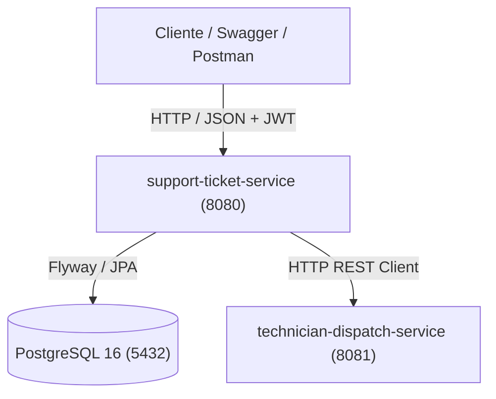
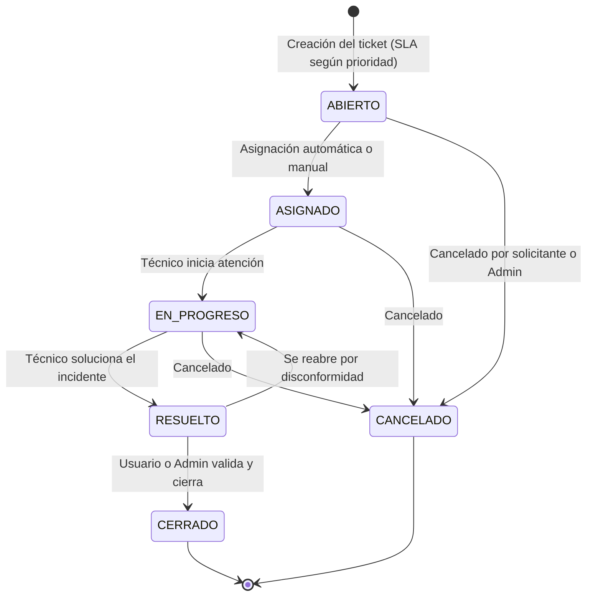

# HelpFlow - Sistema Integral de Gestión de Soporte TI

Solución empresarial para la gestión, asignación, escalamiento y cierre de tickets de soporte técnico distribuido en múltiples sedes, desarrollada bajo arquitectura hexagonal, microservicios, seguridad stateless con JWT, observabilidad con Actuator/Micrometer y contenedorización con Docker.

---

## 1. Arquitectura del Sistema

El ecosistema se compone de dos microservicios:

1. **`support-ticket-service` (Puerto 8080)**:
   - Microservicio principal implementado con **Arquitectura Hexagonal**.
   - Núcleo de dominio desacoplado de dependencias externas.
   - Seguridad stateless basada en tokens JWT con roles (`ROLE_USUARIO`, `ROLE_TECNICO`, `ROLE_ADMIN`).
   - Persistencia avanzada con Spring Data JPA, Hibernate, `@NamedEntityGraph` (sin problema N+1) y migraciones automáticas con Flyway.
   - Observabilidad completa con endpoints de Spring Boot Actuator y métricas Prometheus vía Micrometer.
   - Documentación OpenAPI 3 / Swagger UI interactiva.

2. **`technician-dispatch-service` (Puerto 8081)**:
   - Microservicio liviano simulado para despacho técnico.
   - Genera respuestas deterministas mediante seed numérico a partir del identificador de ticket, categoría y prioridad.



---

## 2. Arquitectura Hexagonal (`support-ticket-service`)

El código sigue estrictamente la separación por capas:

```
src/main/java/com/helpflow/support_ticket_service/
├── domain                                   <-- Dominio Puro (POJOs y Records Java 21)
│   ├── model                                <-- Entidades, Value Objects y Enums
│   │   ├── User.java, Ticket.java, TicketHistory.java
│   │   └── Role, TicketStatus, TicketPriority, TicketCategory...
│   └── exception                            <-- Excepciones de negocio del dominio
│       ├── DomainException.java
│       ├── UserInactiveException.java
│       ├── InvalidStateTransitionException.java
│       └── UnauthorizedTicketAccessException.java
├── application                              <-- Casos de Uso y Puertos
│   ├── port/in                              <-- Puertos de Entrada (Casos de uso)
│   │   ├── RegisterUserPort.java
│   │   ├── AuthenticateUserPort.java
│   │   ├── CreateTicketPort.java
│   │   ├── ManageTicketPort.java
│   │   ├── GetTicketPort.java
│   │   └── EscalateTicketsPort.java
│   ├── port/out                             <-- Puertos de Salida (SPIs)
│   │   ├── UserRepositoryPort.java
│   │   ├── TicketRepositoryPort.java
│   │   ├── TicketHistoryRepositoryPort.java
│   │   ├── TechnicianDispatchPort.java
│   │   ├── PasswordEncoderPort.java
│   │   └── TokenProviderPort.java
│   └── service                              <-- Implementación de los servicios
│       ├── AuthService.java
│       ├── CreateTicketService.java
│       ├── ManageTicketService.java
│       ├── GetTicketService.java
│       └── EscalateTicketsService.java
└── infrastructure                           <-- Adaptadores de Infraestructura
    ├── adapter
    │   ├── rest                             <-- Adaptador Web REST y RFC 7807
    │   │   ├── controller (AuthController, TicketController)
    │   │   ├── dto (Records con Bean Validation)
    │   │   └── advice (GlobalExceptionHandler con RFC 7807)
    │   ├── persistence                      <-- Adaptador JPA + Flyway
    │   │   ├── entity (UserJpaEntity, TicketJpaEntity, TicketHistoryJpaEntity)
    │   │   ├── mapper (MapStruct mappers)
    │   │   └── repository (Spring Data JPA con @EntityGraph)
    │   ├── client                           <-- Adaptador RestClient para technician-dispatch
    │   │   └── TechnicianDispatchRestAdapter.java
    │   ├── security                         <-- Adaptador de Seguridad JWT
    │   │   ├── JwtService.java, SecurityConfig.java, JwtAuthenticationFilter.java
    │   └── metrics                          <-- Adaptador Micrometer / Actuator
    │       └── TicketMetricsAdapter.java
    └── config
        └── OpenApiConfig.java               <-- Configuración de Swagger
```

---

## 3. Ciclo de Vida del Ticket y Reglas de Negocio



### Reglas de Asignación y SLA:
- **Prioridades y SLA**:
  - `CRITICA`: 2 horas
  - `ALTA`: 8 horas
  - `MEDIA`: 24 horas
  - `BAJA`: 48 horas
- **Criterios de Asignación**:
  - Coincidencia de especialidad del técnico (`department`) con la categoría del ticket (`category`).
  - Coincidencia de sede (`location`).
  - Límite máximo de carga activa por técnico (máximo 5 tickets en curso).
  - Consulta inicial a `technician-dispatch-service`.
- **Escalamiento preventivo**:
  - Tickets activos a menos de 2 horas del vencimiento de SLA son escalados automáticamente a prioridad `CRITICA`.

---

## 4. Usuarios Semilla Preconfigurados

Todas las cuentas iniciales poseen la contraseña: `12345`

| Rol | Nombre | Correo | Sede | Departamento / Especialidad |
| :--- | :--- | :--- | :--- | :--- |
| **ROLE_ADMIN** | Juan Morales | `admin@helpflow.com` | SEDE_CENTRAL | INFRAESTRUCTURA |
| **ROLE_TECNICO** | Andres Restrepo | `andres@helpflow.com` | SEDE_NORTE | RED |
| **ROLE_TECNICO** | Santiago Henao | `santiago@helpflow.com` | SEDE_CENTRAL | HARDWARE |
| **ROLE_TECNICO** | Valentina Osorio | `valentina@helpflow.com` | SEDE_SUR | SOFTWARE |
| **ROLE_TECNICO** | Diana Mejia | `diana@helpflow.com` | SEDE_CENTRAL | ACCESOS |
| **ROLE_USUARIO** | Mateo Ramirez | `mateo@helpflow.com` | SEDE_CENTRAL | FINANZAS |
| **ROLE_USUARIO** | Mariana Zapata | `mariana@helpflow.com` | SEDE_NORTE | GESTION_HUMANA |
| **ROLE_USUARIO** | Esteban Correa | `esteban@helpflow.com` | SEDE_SUR | OPERACIONES |
| **ROLE_USUARIO** (Inactivo) | Carolina Agudelo | `carolina@helpflow.com` | SEDE_CENTRAL | VENTAS |

---

## 5. Endpoints Principales

### Autenticación (`/auth`)
- `POST /auth/register`: Registro de nuevos usuarios o técnicos con validación corporativa (`@helpflow.com`).
- `POST /auth/login`: Autenticación y obtención de token JWT.

### Gestión de Tickets (`/tickets`) - Requiere `Authorization: Bearer <TOKEN>`
- `POST /tickets`: Creación de ticket con asignación y cálculo de SLA automáticos.
- `GET /tickets`: Listar tickets permitidos según el rol del usuario autenticado (Usuario: sus propios tickets; Técnico: sus asignados; Admin: todos).
- `GET /tickets/{id}`: Detalle de ticket.
- `PATCH /tickets/{id}/status`: Transición de estado (`targetStatus` y `observations`).
- `PUT /tickets/{id}/reassign`: Reasignación de técnico (solo `ROLE_ADMIN`).
- `GET /tickets/{id}/history`: Auditoría del historial de cambios de estado.
- `POST /tickets/escalate`: Escalamiento de tickets próximos a vencer SLA (solo `ROLE_ADMIN`).

### Documentación y Observabilidad
- **Swagger UI**: `http://localhost:8080/swagger-ui.html`
- **OpenAPI JSON**: `http://localhost:8080/v3/api-docs`
- **Health Check**: `http://localhost:8080/actuator/health`
- **Métricas**: `http://localhost:8080/actuator/metrics`
- **Prometheus**: `http://localhost:8080/actuator/prometheus`

---

## 6. Despliegue con Docker y Docker Compose

### Requisitos:
- Docker y Docker Compose instalados.

### Archivo de Entorno:
Copie el archivo de ejemplo si no existe:
```bash
cp .env.example .env
```

### Iniciar los Servicios:
```bash
docker compose up --build -d
```

### Detener los Servicios:
```bash
docker compose down
```

### Ejecución Local sin Docker:
1. Asegurarse de tener PostgreSQL corriendo en el puerto 5436 (o el configurado en `.env`) con la base de datos `helpflow_db`.
2. Iniciar `technician-dispatch-service`:
   ```bash
   cd technician-dispatch-service
   mvn spring-boot:run
   ```
3. Iniciar `support-ticket-service`:
   ```bash
   cd support-ticket-service
   mvn spring-boot:run
   ```
