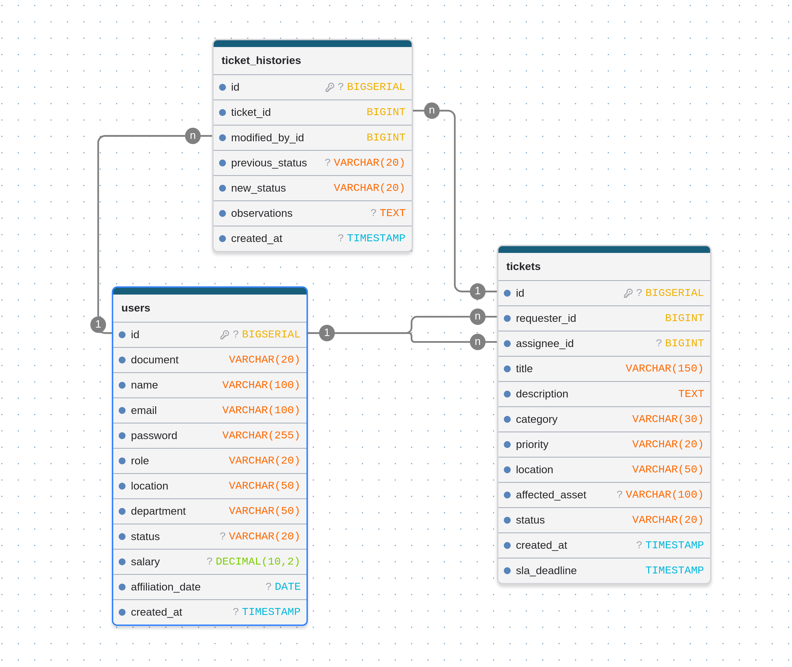
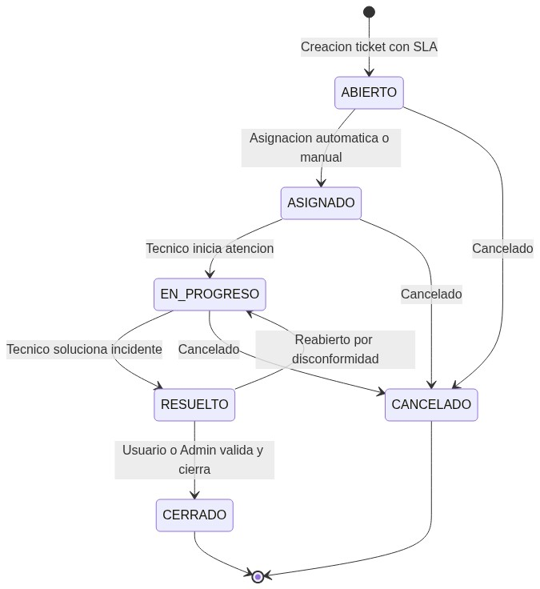
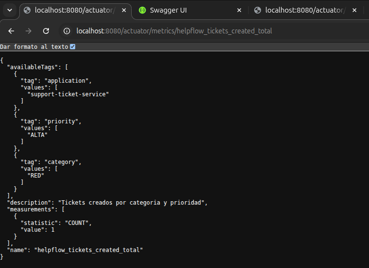
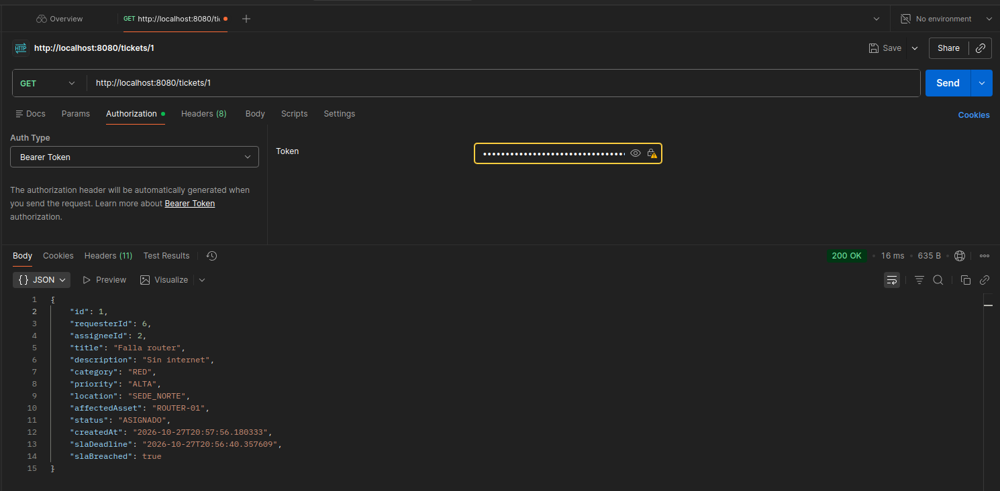

# HelpFlow - Sistema Integral de Gestión de Soporte TI

Solución empresarial para la gestión, asignación, escalamiento y cierre de tickets de soporte técnico distribuido en múltiples sedes, desarrollada bajo arquitectura hexagonal, microservicios, seguridad stateless con JWT, observabilidad con Actuator/Micrometer y contenedorización con Docker.

---

## 1. Arquitectura del Sistema y Relación entre Microservicios

El ecosistema se compone de dos microservicios y una base de datos relacional PostgreSQL:

1. **`support-ticket-service` (Puerto 8080)**:
   - Microservicio principal implementado con **Arquitectura Hexagonal**.
   - Núcleo de dominio desacoplado de dependencias externas.
   - Seguridad stateless basada en tokens JWT con roles (`ROLE_USUARIO`, `ROLE_TECNICO`, `ROLE_ADMIN`).
   - Persistencia avanzada con Spring Data JPA, Hibernate, `@NamedEntityGraph` (sin problema N+1) y migraciones automáticas con Flyway.
   - Observabilidad completa con endpoints de Spring Boot Actuator y métricas Prometheus vía Micrometer.
   - Documentación OpenAPI 3 / Swagger UI interactiva.

2. **`technician-dispatch-service` (Puerto 8081)**:
   - Microservicio liviano simulado para despacho técnico.
   - Genera respuestas deterministas mediante seed numérico a partir del identificador de ticket, categoría y prioridad.

### Diagrama de Relación entre Microservicios:


---

## 2. Diagrama de Arquitectura Hexagonal (`support-ticket-service`)

El servicio principal aísla por completo la lógica de negocio y las entidades del framework y de los adaptadores de entrada/salida:

### Diagrama Visual de Arquitectura Hexagonal:


### Estructura física de paquetes:
```
src/main/java/com/helpflow/support_ticket_service/
├── domain                                   <-- Dominio Puro (POJOs y Records Java 21)
│   ├── model                                <-- Entidades, Value Objects y Enums
│   │   ├── User.java, Ticket.java, TicketHistory.java
│   │   └── Role, TicketStatus, TicketPriority, TicketCategory...
│   └── exception                            <-- Excepciones de negocio del dominio
│       ├── DomainException.java
│       ├── UserInactiveException.java
│       ├── InvalidStateTransitionException.java
│       └── UnauthorizedTicketAccessException.java
├── application                              <-- Casos de Uso y Puertos
│   ├── port/in                              <-- Puertos de Entrada
│   │   ├── RegisterUserPort.java, AuthenticateUserPort.java...
│   ├── port/out                             <-- Puertos de Salida (SPI)
│   │   ├── UserRepositoryPort.java, TicketRepositoryPort.java...
│   └── service                              <-- Implementación de los servicios
│       ├── AuthService.java, CreateTicketService.java...
└── infrastructure                           <-- Adaptadores de Infraestructura
    ├── adapter
    │   ├── rest                             <-- Adaptador Web REST y RFC 7807
    │   ├── persistence                      <-- Adaptador JPA + Flyway
    │   ├── client                           <-- Adaptador RestClient para technician-dispatch
    │   ├── security                         <-- Adaptador de Seguridad JWT
    │   └── metrics                          <-- Adaptador Micrometer / Actuator
    └── config
        └── OpenApiConfig.java               <-- Configuración de Swagger
```

---

## 3. Modelo Entidad-Relación (DER)

El modelo relacional está compuesto por tres tablas principales diseñadas para alta integridad referencial y auditoría inmutable de estados:

### Diagrama DER Visual:


---

## 4. Ciclo de Vida del Ticket y Reglas de Negocio

### Diagrama de Ciclo de Vida del Ticket:


### Reglas de Asignación y SLA:
- **Prioridades y SLA**:
  - `CRITICA`: 2 horas
  - `ALTA`: 8 horas
  - `MEDIA`: 24 horas
  - `BAJA`: 48 horas
- **Criterios de Asignación**:
  - Coincidencia de especialidad del técnico (`department`) con la categoría del ticket (`category`).
  - Coincidencia de sede (`location`).
  - Límite máximo de carga activa por técnico (máximo 5 tickets en curso).
  - Consulta inicial a `technician-dispatch-service`.
- **Escalamiento preventivo**:
  - Tickets activos a menos de 2 horas del vencimiento de SLA son escalados automáticamente a prioridad `CRITICA`.

---

## 5. Usuarios Semilla Preconfigurados

Todas las cuentas iniciales poseen la contraseña: `12345`

| Rol | Nombre | Correo | Sede | Departamento / Especialidad |
| :--- | :--- | :--- | :--- | :--- |
| **ROLE_ADMIN** | Juan Morales | `admin@helpflow.com` | SEDE_CENTRAL | INFRAESTRUCTURA |
| **ROLE_TECNICO** | Andres Restrepo | `andres@helpflow.com` | SEDE_NORTE | RED |
| **ROLE_TECNICO** | Santiago Henao | `santiago@helpflow.com` | SEDE_CENTRAL | HARDWARE |
| **ROLE_TECNICO** | Valentina Osorio | `valentina@helpflow.com` | SEDE_SUR | SOFTWARE |
| **ROLE_TECNICO** | Diana Mejia | `diana@helpflow.com` | SEDE_CENTRAL | ACCESOS |
| **ROLE_USUARIO** | Mateo Ramirez | `mateo@helpflow.com` | SEDE_CENTRAL | FINANZAS |
| **ROLE_USUARIO** | Mariana Zapata | `mariana@helpflow.com` | SEDE_NORTE | GESTION_HUMANA |
| **ROLE_USUARIO** | Esteban Correa | `esteban@helpflow.com` | SEDE_SUR | OPERACIONES |
| **ROLE_USUARIO** (Inactivo) | Carolina Agudelo | `carolina@helpflow.com` | SEDE_CENTRAL | VENTAS |

---

## 6. Endpoints Principales

### Autenticación (`/auth`)
- `POST /auth/register`: Registro de nuevos usuarios o técnicos con validación corporativa (`@helpflow.com`).
- `POST /auth/login`: Autenticación y obtención de token JWT.

### Gestión de Tickets (`/tickets`) - Requiere `Authorization: Bearer <TOKEN>`
- `POST /tickets`: Creación de ticket con asignación y cálculo de SLA automáticos.
- `GET /tickets`: Listar tickets permitidos según el rol del usuario autenticado (Usuario: sus propios tickets; Técnico: sus asignados; Admin: todos).
- `GET /tickets/{id}`: Detalle de ticket.
- `PATCH /tickets/{id}/status`: Transición de estado (`targetStatus` y `observations`).
- `PUT /tickets/{id}/reassign`: Reasignación de técnico (solo `ROLE_ADMIN`).
- `GET /tickets/{id}/history`: Auditoría del historial de cambios de estado.
- `POST /tickets/escalate`: Escalamiento de tickets próximos a vencer SLA (solo `ROLE_ADMIN`).

### Microservicio de Disponibilidad Técnica (`technician-dispatch-service:8081`)
- `POST /technician-dispatch`: Cálculo determinista de disponibilidad técnica y tiempo estimado.

---

## 7. Swagger UI y Colección de Pruebas (Postman)

### A. Documentación Interactiva Swagger UI / OpenAPI 3
La API está completamente documentada con OpenAPI 3 y permite probar todos los endpoints desde el navegador con soporte nativo para autenticación JWT:
- **Swagger UI**: [http://localhost:8080/swagger-ui.html](http://localhost:8080/swagger-ui.html)
- **Especificación OpenAPI (JSON)**: [http://localhost:8080/v3/api-docs](http://localhost:8080/v3/api-docs)

> **Cómo autenticarse en Swagger UI:**
> 1. Inicie sesión mediante el endpoint `POST /auth/login` con cualquiera de los usuarios semilla (por ejemplo `admin@helpflow.com` y clave `12345`).
> 2. Copie el token retornado en el campo `token`.
> 3. En la parte superior derecha de Swagger UI, haga clic en el botón verde **Authorize** 🔓.
> 4. En el campo `Value`, ingrese: `Bearer <SU_TOKEN>` (o pegue directamente el token) y presione **Authorize**.
> 5. A partir de ese momento, todas las solicitudes que ejecute incluirán el encabezado `Authorization`.

---

### B. Colección de Postman Lista para Importar
El proyecto incluye una colección completa de Postman con pruebas automatizadas y un entorno de variables locales preconfigurado en la carpeta `docs/postman/`:
- **Colección**: `docs/postman/HelpFlow.postman_collection.json`
- **Entorno**: `docs/postman/HelpFlow.postman_environment.json`

#### Estructura de la Colección:
1. **`01 - Autenticación y Usuarios`**:
   - `1.1 Registrar Usuario Válido`: Valida creación de usuario con dominio `@helpflow.com` (Código HTTP 201).
   - `1.2 Login Administrador`: Autentica a Juan Morales (`admin@helpflow.com`) y guarda automáticamente `{{admin_token}}` y `{{jwt_token}}` mediante script.
   - `1.3 Login Técnico`: Autentica a Andres Restrepo (`andres@helpflow.com`) y almacena `{{tecnico_token}}`.
   - `1.4 Login Usuario Solicitante`: Autentica a Mateo Ramirez (`mateo@helpflow.com`) y almacena `{{usuario_token}}`.
2. **`02 - Gestión de Tickets (Flujo Principal)`**:
   - `2.1 Crear Ticket`: Crea un nuevo ticket como usuario solicitante, calcula SLA y consulta el microservicio externo. Guarda automáticamente `{{createdTicketId}}`.
   - `2.2 Listar Tickets`: Consulta tickets filtrados según los permisos del rol autenticado.
   - `2.3 Consultar Ticket por ID`: Obtiene el detalle de un ticket específico.
   - `2.4 Transición de Estado a EN_PROGRESO`: Registra el inicio de atención con observaciones técnicas.
   - `2.5 Transición de Estado a RESUELTO`: Concluye el soporte con detalle de la solución implementada.
   - `2.6 Reasignar Ticket (Solo Admin)`: Reasigna el ticket a otro técnico verificando control de acceso RBAC.
   - `2.7 Consultar Historial y Auditoría`: Lista todos los cambios de estado, fechas, observaciones y usuario responsable.
   - `2.8 Escalar Tickets Próximos a Vencer SLA (Solo Admin)`: Ejecuta el caso de uso de escalamiento preventivo.
3. **`03 - Microservicio technician-dispatch-service`**:
   - `3.1 Consultar Disponibilidad Técnica Determinista`: Prueba el microservicio en el puerto `8081` (`POST /technician-dispatch`).
4. **`04 - Observabilidad y Métricas`**:
   - `4.1 Actuator Health`: Verifica el estado de salud del servicio y de la base de datos PostgreSQL (`UP`).
   - `4.2 Actuator Info`: Consulta la metadata de la aplicación.
   - `4.3 Listado de Métricas Actuator`: Expone todas las métricas activas en Spring Boot.
   - `4.4 Métrica Micrometer (Tickets Incumplidos SLA)`: Consulta `helpflow_tickets_breached_sla_total`.
   - `4.5 Métricas Formato Prometheus`: Expone las métricas para recolección vía Prometheus (`/actuator/prometheus`).
5. **`05 - Casos de Error y Validaciones RFC 7807`**:
   - `5.1 Error 400 - Correo no corporativo`: Verifica el rechazo de correos no institucionales con formato `ProblemDetail`.
   - `5.2 Error 400 - Transición inválida`: Intenta cerrar un ticket abierto sin pasar por resuelto.
   - `5.3 Error 401 - Petición sin token`: Intenta consultar tickets sin cabecera de autorización.
   - `5.4 Error 403 - Acceso denegado`: Usuario estándar intentando reasignar técnicos (acción restringida a administradores).
   - `5.5 Error 404 - Ticket inexistente`: Verifica la respuesta de recurso no encontrado bajo RFC 7807.

#### Cómo importar y ejecutar en Postman:
1. Abra Postman y haga clic en **Import** (en la esquina superior izquierda).
2. Arrastre o seleccione los dos archivos:
   - `docs/postman/HelpFlow.postman_collection.json`
   - `docs/postman/HelpFlow.postman_environment.json`
3. En la esquina superior derecha de Postman, seleccione el entorno activo **"HelpFlow - Entorno Local"**.
4. Ejecute primero las peticiones de login en la carpeta **01 - Autenticación y Usuarios**; los scripts integrados capturarán los tokens JWT y los guardarán automáticamente en las variables del entorno para que las demás peticiones funcionen de inmediato sin copiar ni pegar manualmente.
5. Puede hacer clic en los tres puntos de la colección y seleccionar **Run collection** para ejecutar todas las pruebas en lote y comprobar las aserciones en verde.

---

## 8. Evidencias de Observabilidad, Métricas y Logs

### A. Métricas Generales en Spring Boot Actuator (`/actuator/metrics`)
Consulta del listado completo de métricas del sistema, incluyendo métricas personalizadas del dominio HelpFlow (`helpflow_*`):


---

### B. Métrica de Tickets Creados por Categoría y Prioridad (`helpflow_tickets_created_total`)
Conteo dinámico de tickets creados con tags de dimensión para categorización y análisis:



---

### C. Métrica en Formato Prometheus (`/actuator/prometheus`)
Exposición de métricas listas para scraping en formato estándar Prometheus (OpenMetrics):


---

### D. Detección y Métrica de Tickets Vencidos según SLA

1. **Métrica `helpflow_tickets_breached_sla_total` reflejando tickets fuera de tiempo (`value: 1.0`)**:
   

2. **Detalle del ticket vía API (`GET /tickets/1`) mostrando `"slaBreached": true`**:
   

---

### E. Logs Estructurados
Registro de trazas con formato estructurado ISO 8601, niveles de severidad (`INFO`, `WARN`), identificación de hilos y captura de excepciones mediante el manejador global RFC 7807:


---

## 9. Despliegue con Docker y Docker Compose

### Requisitos:
- Docker y Docker Compose instalados.

### Archivo de Entorno:
Copie el archivo de ejemplo si no existe:
```bash
cp .env.example .env
```

### Iniciar los Servicios:
```bash
docker compose up --build -d
```

### Detener los Servicios:
```bash
docker compose down
```

### Ejecución Local sin Docker:
1. Asegurarse de tener PostgreSQL corriendo en el puerto 5436 con la base de datos `helpflow_db`.
2. Iniciar `technician-dispatch-service`:
   ```bash
   cd technician-dispatch-service
   mvn spring-boot:run
   ```
3. Iniciar `support-ticket-service`:
   ```bash
   cd support-ticket-service
   mvn spring-boot:run
   ```
